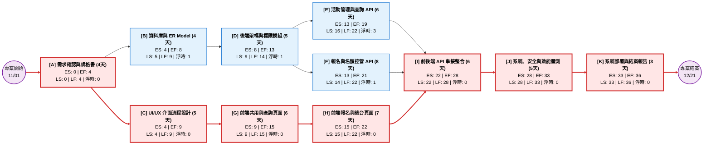
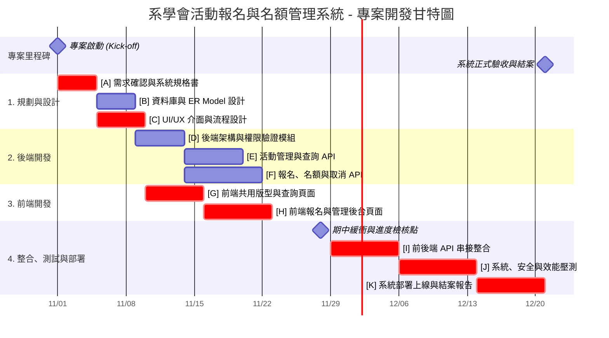

### 專案團隊分工表（5 人編制）

本專案採「前後端分離」與「功能模組化」分工，確保關鍵路徑（要徑）任務有專人負責推進，同時讓前後端能同步平行開發：

| 成員代號 |負責任務代號 | 負責工作項目與具體職責 | 對應系統需求 | 預估總工期 |
| :---: | :---: | :--- | :---: | :---: |
| **組員 1** |  **A, I, K** | • 統籌專案進度、主持會議與控管時程 • 撰寫需求與系統規格書（任務 A） • 主導前後端 API 串接整合（任務 I） • 負責系統部署上線與結案報告整理（任務 K） | 全體需求[cite: 2] | 13 天 |
| **組員 2** |  **B, D, E** | • 設計資料庫正規化與 ER Model（任務 B） • 建置後端基礎架構與權限驗證攔截器（任務 D） • 開發活動管理與清單/詳情查詢 API（任務 E） | FR-01, FR-05 NFR-01, NFR-02[cite: 2] | 15 天 |
| **組員 3** |  **F** *(支援 B, I)* | • 開發學生報名、名額扣減與取消釋出 API（任務 F） • 實作資料庫交易鎖定（防止併發超賣與重複報名） • 開發管理員匯出/查看報名名單 API • 協助資料庫索引設計（B）與 API 串接除錯（I） | FR-02, FR-03 FR-04, FR-06 NFR-01[cite: 2] | 14 天 *(含支援)* |
| **組員 4** |  **C, G** | • 繪製全站線框圖與操作流程，確保「3 步驟內完成報名」（任務 C） • 開發前端共用版型、導覽列與響應式架構 • 開發學生端「活動清單頁」與「活動詳細頁」（任務 G） | FR-01 NFR-03[cite: 2] | 11 天 |
| **組員 5** |  **H, J** | • 開發學生「報名/取消互動介面」與「管理員後台頁面」（任務 H） • 撰寫測試案例並執行安全性越權測試（任務 J） • 執行 100 筆資料 / 20 人同時在線之 3 秒回應效能壓測 | FR-02, FR-04~06 NFR-01~03[cite: 2] | 12 天 |

### 1. CPM 時間參數計算表（單位：天）

 **ES（最早開始）**、**EF（最早結束）**、**LS（最晚開始）**、**LF（最晚結束）** 與 **Slack（寬裕時間/浮時）**：

| 代號 | 任務名稱 | 工期 | 前置 | ES | EF | LS | LF | 浮時 (Slack) | 是否為要徑 |
| :---: | :--- | :---: | :---: | :---: | :---: | :---: | :---: | :---: | :---: |
| **A** | 需求確認與規格書 | 4 | 無 | 0 | 4 | 0 | 4 | **0** | **是（要徑）** |
| **B** | 資料庫與 ER Model | 4 | A | 4 | 8 | 5 | 9 | 1 | 否 |
| **C** | UI/UX 介面與流程設計 | 5 | A | 4 | 9 | 4 | 9 | **0** | **是（要徑）** |
| **D** | 後端架構與權限模組 | 5 | B | 8 | 13 | 9 | 14 | 1 | 否 |
| **E** | 活動管理與查詢 API | 6 | D | 13 | 19 | 16 | 22 | 3 | 否 |
| **F** | 報名、名額與取消 API | 8 | D | 13 | 21 | 14 | 22 | 1 | 否 |
| **G** | 前端共用版型與查詢頁 | 6 | C | 9 | 15 | 9 | 15 | **0** | **是（要徑）** |
| **H** | 前端報名與管理後台頁 | 7 | G | 15 | 22 | 15 | 22 | **0** | **是（要徑）** |
| **I** | 前後端 API 串接整合 | 6 | E, F, H | 22 | 28 | 22 | 28 | **0** | **是（要徑）** |
| **J** | 系統、安全與效能壓測 | 5 | I | 28 | 33 | 28 | 33 | **0** | **是（要徑）** |
| **K** | 系統部署與專案結案 | 3 | J | 33 | 36 | 33 | 36 | **0** | **是（要徑）** |

>  `A → C → G → H → I → J → K`，總核心工期為 **36 天**。

